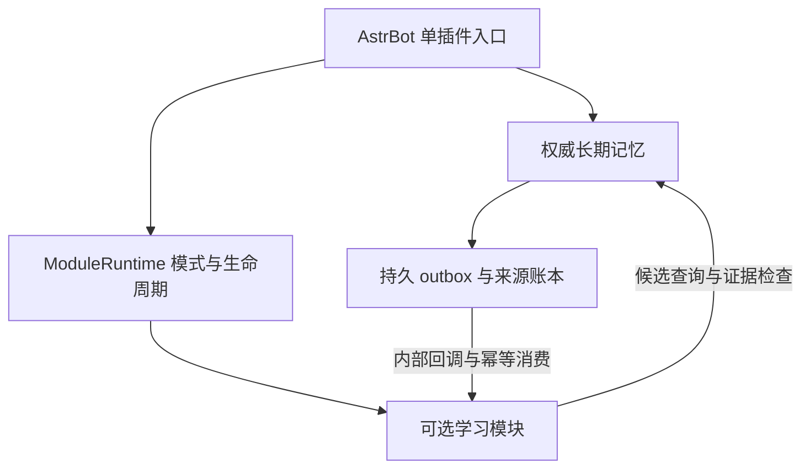

# AstrBot 长期记忆框架 1.1.0

此项目用于为 AstrBot 中部署的llm模型提供更强大的持续记忆与自主学习能力

此插件的开发特别感谢 [astrbot_plugin_livingmemory](https://github.com/lxfight-s-Astrbot-Plugins/astrbot_plugin_livingmemory) 与 [astrbot_plugin_self_learning](https://github.com/NickCharlie/astrbot_plugin_self_learning) 项目，此插件开发时特别参考了 livingmemory 插件的 2.7.0beta3 版本与 self_learning 插件的 v4.0.0 版本

- [介绍](#introduce)
- [安装与模块选择](#installation)
- [配置与数据](#configuration)
- [命令、面板与排查](#usage)
- [模块架构与接口](#architecture)
- [Usage 统计与提示词布局](#llm-usage)
- [开发、构建与验证](#development)
- [保留文档与来源](#documentation)

<a id="installation"></a>

## 介绍

本插件旨在解决群聊环境中，存在多说话人、多话题交错且时间接近情况下LLM可能会出现记忆跨会话污染，或者记忆过久时出现幻觉的问题，同时额外引入了自主学习能力，允许记忆内容向KB传播，自主建立知识库。下面是本插件的（部分）技术路径：

此插件的设计与评估目标最初设定为 1600消息/day ，平均输入 11 字，转换为纯中文文本约 52.8 KB/day，因此若您在大量群聊上运行此插件时，磁盘与token消耗可能会比下方的评估值更高

模型采用以下的分层方式：

- **L0 最近文本**：当前消息或引用，及有界的近期上下文
- **L1 摘要**：带来源的线程或时间段摘要
- **L2 情景记忆**：可定位到具体消息的事件、原话或者小块文本
- **L3 结构化记忆**：带主题、属性、时间等的偏好与决定等
- **KB 知识分层**：独立审核、版本化且有可见范围的知识库内容

由于本插件并未引入主动焦点机制，因此本插件在您设置较长的上下文时，模型可能会出现失焦导致本插件无法发挥其最大作用，且可能与 context 发生混淆，因此建议您将上下文窗口设置为 128-256k 策略为截断/压缩以保证模型可能需要进行的长程任务能力以及短时间连续对话能力

本插件的设计流如下：

~~~text
来自可信平台的事件
 -> 访问范围解析 + 采集策略 + 校验
 -> SQLite 事务：原文/修订 + outbox 任务
 -> 异步工作器：线程候选、实体链接、摘要、事实候选
 -> 来源校验 + 冲突处理 + 版本化派生记录
 -> 按 scope 构建全文/向量/实体索引

用户查询 + 可信事件身份
 -> 服务端解析允许的 scope 和当前状态
 -> 查询解析 + 精确检索/BM25/dense
 -> 融合 + 重排 + 证据去重
 -> 授权范围内扩展原文与回复链
 -> 再校验权限/删除状态 + token 预算
 -> LLM 回答 + 可核验引用
 -> 反馈、纠正及审计
~~~

若您希望按照此路径实现一个其他框架或平台下的记忆插件，您可以按照以下的路径实现：

首先实现采集、scope 隔离、原文与来源关联、中文全文检索、有界 L0、明确拒答和软删除。随后加入小块向量与重排。图谱、全自动事实抽取、多跳代理和自动生命周期属于增强手段，您可在后续维护中加入

---

此插件会记录以下的内容

| 记录 | 关键字段 | 任务 |
|---|---|---|
| `memory_scope` | 部署、实例、类型、会话键、policy_version | 隔离单元及策略版本 |
| `raw_message` | 内部 UID、scope、平台消息号、revision、sender、事件时间、入库时间、reply_to、原文 | 权威消息及修订 |
| `message_thread` | 消息 UID、线程候选、置信度、算法版本 | 可修正的多话题归属 |
| `entity` / `entity_alias` | scope、稳定用户 ID、实体 ID、别名和有效区间 | 消歧义，避免同昵称内容混淆 |
| `memory_item` | scope、kind、subject、predicate、object、reporter、有效时间、证据状态、版本 | 原子主张或派生摘要 |
| `memory_source` | memory ID、原文 UID、证据角色、必要时字符区间 | 多对多来源 |
| `derivation_edge` | 父子派生项、构建版本 | 原文到摘要、图谱、KB 的失效传播 |
| `embedding` | 对象与版本、模型指纹、维度、距离、归一化、chunk 版本 | 防止索引混用 |
| `outbox_job` | 对象、版本、任务类型、状态、重试、唯一键 | 事务后可恢复的异步处理 |
| `retrieval_log` / `feedback` | 请求、scope、来源、分数、操作人、结果、时间 | 诊断与纠正，避免重复存储正文 |

其中涉及部分字段语义如下：

~~~json
{
 "scope_id": "S-demo-001",
 "kind": "preference",
 "subject_entity_id": "E-user-B",
 "reporter_id": "user-A",
 "predicate": "prefers",
 "object": "coffee",
 "epistemic_status": "reported",
 "confidence": 0.6,
 "event_time": "2026-10-22T13:22:00Z",
 "valid_from": null,
 "valid_to": null,
 "tier": "hot",
 "status": "active",
 "pinned": false,
 "version": 1,
 "source_uids": ["M-demo-001"],
 "supersedes": null,
 "soft_deleted_at": null,
 "restore_until": null
}
~~~

`source_uids`为接口展示字段；`confidence` 表示经过校准的抽取/证据可靠度或明确标注的启发式分数，不等同于命题成立概率，取值范围0-1；LLM 自报置信度只能作为特征；`kind` 指消息的实际类型，可取 `quote/event/preference/claim/summary` 等， `epistemic_status` 用于表示llm对于此记忆的认知状态，可取 `reported/self_reported/corroborated/inferred/joked/uncertain` ，其中当 `epistemic_status` 取值 `corroborated` 时必须附带依据

为了令llm可以解释模糊时间，字段中会嵌入 `event_time` ，并通过 `valid_from/to` 主张消息的适用区间，但这并不会成为唯一解释项，避免强行指定适用区间时llm越过该记忆

`tire` 存储了记忆温度，可取值 `hot/warm/cold/archived`，对应记忆的索引情况，其中较少调用的记忆将会被归类至 `cold/archived` 其中被归类至 `archived` 的记忆将不会参与主动召回，非手动更改情况下，记忆温度不允许跨越或连续修改；`status` 表示当前记忆的状态，本插件引入了以下的记忆状态：
>active：记忆处于活跃状态，且记忆事实无明显变化
>
>superseded：记忆存储的事实已变动，但记忆未被清除，后续对话中仍可通过引导调用此部分记忆
>
>disputed：记忆存储的事实存在争议，常见为在当前记忆方法下，临近事实文本中出现了相悖的事实
>
>soft_deleted：记忆被软删除，在非手动调用情况下llm通常不会调用此部分记忆
>
>quarantined：记忆被隔离，常见于记忆需要被传播到KB，审核尚未通过，或记忆不应当被修改时

上面的方式避免了已经失效的消息继续影响回答和学习结果。本地增加的来源账本、持久撤销通知和恢复补投，解决了记忆与学习之间的一致性问题。本插件通过以下的多因子加权公式来设定优先级并实现上面的记忆状态变化：

~~~text
priority = w1*importance + w2*evidence_quality + w3*recency_bu_kind + w4*independent_mentions + w5*explicit_feedback - w6*redundancy
~~~

对于同时满足多个条件的群内术语，将会进行群内 KB路由 ，加入到本群私有数据库中，此行为在跨群或全局 KB 传播中被禁止，需要单独进行审核，模型仅可提出候选，无法自主扩大访问范围

由于内容过多，剩余内容不再在本节展开讲解。在验证阶段中，采用模型 `DeepSeek-flash1017` 作为主输入/输出以及抽取和生成模型，`qwen-4B-embedding(1024维)` 作为向量生成与召回模型，上下文配置为 128k 截断，消息数16000+50000，合计测试36000轮，在**每轮都调用此插件的情况下**测试持续约3小时，共计花费3000w token，其中缓存命中率平均50.2%，其中16000消息下缓存命中率约64%，50000消息下缓存命中率约43%，实际测试中 `DeepSeek-flash1017` 完全作为主模型时，缓存命中率约93%-95%，取决于记忆单日调用次数和生成次数，在1.1.0中，通过优化了提示词注入位置和布局以及共有前缀，预计本插件的缓存命中率可以有部分提升并减少记忆和学习组件带来的开销。其中，36000轮测试成绩如下：

| 指标 | 16,000条消息 | 50,000条消息 |
| --- | ---: | ---: |
| 检索问题数 | 16,000 | 16,000 |
| 实际回答评测数 | 16,000 | 16,000 |
| Recall@5，12,000道有答案题 | 91.67% | 98.10% |
| Hit@5，至少一条相关证据 | 92.73% | 99.50% |
| Top-1证据准确率，有答案题 | 88.09% | 94.68% |
| 全部必要证据召回，有答案题 | 90.61% | 96.69% |
| 返回证据精确率，所有题微平均 | 15.90% | 16.98% |
| 无答案题检索空结果率 | 0.00% | 0.00% |
| 严格字段回答正确率，全部已评题 | 89.16% | 93.53% |
| 严格字段回答正确率，有答案题 | 85.54% | 91.37% |
| 回答正确且引用齐全，全部已评题 | 89.15% | 93.52% |
| 回答正确且引用齐全，有答案题 | 85.53% | 91.36% |
| 无答案题正确拒答率 | 100.00% | 100.00% |
| 选择回答时的正确率 | 94.39% | 94.45% |
| 标准事实均正确（附加诊断，允许额外字段） | 91.95% | 96.54% |

50,000相对16,000条消息：Recall变化 **+6.43个百分点（未舍入值+6.425）**；共同已评问题的回答正确率变化 **+4.37个百分点**；回答正确且引用齐全变化 **+4.37个百分点**

由于无法完全还原群聊下的复杂场景，且考虑到使用模型与场景的不同，本评估仅能用于参考。其中本评估实际消耗的价格（1.0.0版本）供您参考：\
`DeepSeek-flash1017` 高峰时段，官方API：83.68¥ \
硅基流动 `Qwen-4B-embedding(1024维)`：3.45¥

## 安装与模块选择

从 Git 克隆的源码不包含被忽略的 `dist/`。请先在仓库根目录运行 `python tools/build_release.py` 生成安装包，再上传或执行安装工具。运行依赖由 AstrBot 安装，Provider 与密钥请在 AstrBot 面板中配置。

| `framework_modules.mode` | 行为 |
|---|---|
| `memory_and_learning`（默认） | 保留长期记忆、学习、反馈强化、人格审查、黑话、社交与既有可选功能；各功能继续服从自己的配置开关。 |
| `memory_only` | 保留长期记忆；不导入学习实现，不初始化学习数据库连接、服务或后台任务。已有学习数据保留。 |

修改模式后重载插件或重启 AstrBot 生效。`/lmem modules` 查看模式与学习模块状态。

停机后的全新文件系统安装：

```sh
python tools/install.py --data-dir /path/to/astrbot/data
python tools/install.py --data-dir /path/to/astrbot/data --apply
```

<a id="migration"></a>

## 配置与数据

完整字段见 [插件配置 schema](plugins/astrbot_plugin_livingmemory/_conf_schema.json) 和 [框架默认预设](presets/astrbot_plugin_livingmemory.merge.json)。根 schema 合并原两份配置分组；内部 `learning/_conf_schema.json` 保留学习面板需要的结构。学习配置由 `learning/config.py::PluginConfig.create_from_config()` 转换为运行时对象。

| 配置 | 当前框架行为或用途 |
|---|---|
| `provider_settings.embedding_provider_id` / `llm_provider_id` | 记忆向量与摘要模型；在 AstrBot 中选择相应 Provider。 |
| `filtering_settings.memory_scope_mode` | 默认 `session`；会话过滤和人格过滤默认开启。 |
| `agent_tools.max_total_evidence_bytes` | 默认 `7000`；自动注入、搜索和深读共享的证据字节预算，不等于模型 token 上限。 |
| `Target_Settings.target_qq_list` / `target_blacklist` | 学习目标与排除列表；空白名单默认学习非黑名单消息，部署前按需要限制范围。 |
| `Model_Configuration.filter_provider_id` / `refine_provider_id` / `reinforce_provider_id` | 学习筛选、提炼与反馈强化使用的 Provider。未就绪时延迟初始化，相关功能可能降级。 |
| `Self_Learning_Basic.enable_message_capture` / `enable_auto_learning` | 默认开启；实时学习 `enable_realtime_learning` 默认关闭。 |
| `Database_Settings.db_type` | 新部署默认 `sqlite`；也支持已配置的 PostgreSQL/MySQL。 |
| `Storage_Settings.data_dir` | 留空时沿用默认学习数据目录；迁移时保留已有自定义路径。 |
| `Advanced_Settings.auto_apply_approved_persona` | 默认关闭；人格学习与审查不会因此自动改写当前人格。 |
| `Runtime_Internal_Settings.enable_llm_hooks` | 框架默认开启；默认注入目标为 `extra_user_content_parts`。 |
| `Self_Learning_Basic.enable_web_interface` | 独立学习 WebUI 默认关闭；与 AstrBot 内嵌学习面板分开控制。 |

学习链路包括消息采集、表达与黑话学习、群组批量学习、人格/风格审查和请求上下文注入。产物应先在审查页面核对；关闭原始消息保存后，依赖原始记录的后续学习将没有新样本。学习阈值、批次大小、间隔与权重沿用现有配置。

数据库类型、连接地址、存储目录和 WebUI 监听参数变更后需要重载或重启。SQLite 学习库通常位于学习数据目录的 `messages.db`；自定义 `messages_db_path` 优先。学习数据库的轻量迁移负责新增缺失表和列，不负责删除、重命名或复杂类型转换；这类迁移需要单独设计与回退方案。备份时同时保留配置、人格、数据库和来源账本。

<a id="usage"></a>

## 命令、面板与排查

记忆面板位于 AstrBot 插件 Pages 的 `dashboard`，学习面板位于同一插件的 `learning` 页面。学习关闭时不注册学习页面后端路由；重新启用后恢复。

| 命令 | 用途 |
|---|---|
| `/lmem modules` | 查看当前模块模式和学习状态。 |
| `/lmem status` | 查看记忆统计和后台索引检查、重建进度。 |
| `/lmem search <query> [k]` | 搜索长期记忆，`k` 默认为 5。 |
| `/lmem summarize [message_count]` | 立即总结当前会话，或重总结最近 N 条消息。 |
| `/lmem forget <id>` | 删除指定记忆。 |
| `/lmem rebuild-index` / `/lmem rebuild-graph` | 重建文档索引或图谱索引。 |
| `/lmem migrate-scope <target> [apply] [source]` | 迁移既有记忆作用域；默认预览，`apply` 才写入。 |
| `/lmem reset` / `/lmem cleanup [preview\|exec]` | 重置当前会话记忆上下文，或清理历史消息中的旧记忆注入。 |
| `/lmem webui` / `/lmem help` | 查看面板入口或命令帮助。 |
| `/learning_status` | 查看学习状态与统计。 |
| `/start_learning` / `/stop_learning` / `/force_learning` | 启动、停止或触发学习。 |
| `/remember <引用或上下文> => <表达示例>` | 手动记录上下文与表达示例。 |
| `/clean_rag_cache` | 清理学习模块的 RAG 缓存。 |
| `/affection_status` / `/set_mood <类型>` | 查看好感度或设置情绪。 |

命令保留既有权限校验，学习管理命令需要 AstrBot 管理员权限。

独立学习 WebUI 需要显式开启，默认监听 `127.0.0.1:7833`。免密模式只接受本机访问；远程访问需要配置登录密码并启用 `enable_webui_password`，再调整监听地址。Hub API 在未启用 API 鉴权时也仅允许本机调用，跨机调用需要 `API_Settings.enable_api_auth` 与 `api_key`。具体安全说明见 [SECURITY.md](plugins/astrbot_plugin_livingmemory/learning/SECURITY.md)。

学习面板可查看学习内容、待审人格与风格、黑话、社交关系、图谱和功能融合状态。世界书与聊天记录导入位于融合功能中；影子模式从已有消息生成语言风格档案，按目标群生效，受 LLM Hook 总开关控制。它只影响已有回复的表达方式，不应冒充被学习用户的身份。编辑、删除、批量审查和人格恢复应先核对对象。

WebUI 的额外依赖安装需要设置页的手动确认；接口为 `POST /api/dependencies/install`，请求包含 `manual_confirmed=true`、`source=webui_settings` 和所选 `tier`。`ASTRBOT_ENABLE_WEB_DEP_INSTALL=false` 可以禁用此入口；模块导入或 bootstrap 不自行执行 pip 安装。

| 现象 | 排查顺序 |
|---|---|
| 搜不到刚聊的内容 | 先 `/lmem summarize` 确认入库，再检查作用域、人格过滤及 Provider。 |
| 学习没有产出 | 检查模块模式、采集开关、目标/黑名单、消息长度、数据库记录、批次阈值、学习间隔、Provider 和待审列表。 |
| 索引异常 | 用 `/lmem status` 查看 `checking`、`rebuilding`、`partial`、`failed` 或 `cancelled`；检查 Provider 后按需重建，不重复启动正在进行的任务。 |
| 更换 Embedding 后召回异常 | 等待 Provider 指纹检查触发向量重建，并观察进度。 |
| 学习页面不可用 | 检查 `memory_and_learning` 与模块启动状态；独立 WebUI 另查开关、端口、监听地址和访问认证。 |
| FAISS 加载失败 | 检查 AstrBot 实际 Python 环境中的 wheel、CPU 指令集及 Python/二进制版本是否匹配。 |

<a id="architecture"></a>

## 模块架构与接口

唯一宿主入口为 `plugins/astrbot_plugin_livingmemory/main.py`。`core/unified_runtime.py` 管理学习模块的装载、状态、命令转发与关闭；`learning/module.py::LearningModule` 是普通 Python 类。



请求前按“记忆召回 → 学习证据 Hook”调用；发送后按“会话重置处理 → 学习出站采集”调用。学习通过绑定的 `memory_authority` 访问权威记忆，不扫描注册表寻找内部模块。外部 Group Chat Plus 的发现与回复委托保留兼容逻辑。

来源撤销通过持久 outbox、来源账本和幂等消费传递。学习停用、启动失败或关停中不能确认撤销已送达；恢复后补投并核对账本。关停时先关闭学习再清理记忆资源，学习关闭失败也继续记忆清理。

外部 Python 调用者通过 AstrBot 注册表获取唯一 LivingMemory 实例，再调用 `find_evidence_candidates`、`govern_external_context`；不要另建记忆引擎或直接打开其数据库。独立学习 WebUI 开启后，HTTP 调用者可先读取 `/api/hub/v1/manifest` 和 `/api/hub/v1/status`，再按返回能力调用 `context`、`memories/remember`、`messages/ingest`、`learning/trigger`、审查、图谱或指标接口。启用 API 鉴权时使用 `Authorization: Bearer <api_key>` 或 `X-Self-Learning-Key`。

| 源码位置（相对插件目录） | 维护职责 |
|---|---|
| `core/processors/`、`core/prompts/` | 摘要、合并与提示词。 |
| `core/retrieval/`、`storage/` | 检索排序、记忆存储和持久任务。 |
| `learning/core/plugin_lifecycle.py`、`learning/core/factory.py` | 学习生命周期与服务组装。 |
| `learning/services/learning/`、`learning/services/core_learning/` | 消息流水线、表达学习与批量学习。 |
| `learning/services/quality/`、`learning/services/hooks/` | 质量评估与 LLM 请求注入。 |
| `learning/core/database/`、`learning/services/database/`、`learning/models/orm/` | 数据库引擎、Facade 与 ORM。 |
| `learning/webui/blueprints/`、`learning/webui/services/` | HTTP 接口与页面业务逻辑。 |

<a id="llm-usage"></a>

## Usage 统计与提示词布局

私聊摘要、群聊摘要和记忆合并的每次实际 Provider 尝试结束时，会输出 INFO 级 `[LivingMemoryUsage]` 结构化日志。重试共享 `logical_call_id`，每次尝试具有独立 `request_id`；非流式失败与流式回退分别计数。Provider 不存在且未发出调用时不计 API 尝试。

| 字段 | 口径 |
|---|---|
| `operation`、`provider_hash`、`model` | 任务类型、Provider 标识哈希与模型。 |
| `status`、`attempt`、`transport` | 调用状态、尝试序号与流式/非流式方式；成功不代表摘要质量或入库成功。 |
| `input_tokens`、`cached_input_tokens`、`uncached_input_tokens` | 总输入及缓存拆分；未知值为 `null`。 |
| `output_tokens`、`reasoning_tokens`、`total_tokens` | 输出、推理明细和总量；推理 token 不重复累加。 |
| `usage_source`、`usage_status` | 来源及 reported / partial / unavailable / inconsistent 状态。 |
| `elapsed_ms` | 单次调用尝试耗时，不包括退避，也不是首 token 延迟或完整入库耗时。 |
| `system_prompt_sha256`、`prompt_sha256` | 实际文本哈希，不是服务端缓存键。 |

优先采用原始响应 usage，保留显式零值；没有缓存字段时不把归一化默认零视为确认未命中，矛盾计数不参与命中率。原始 usage 缺失时才回退到 AstrBot 归一化数据，其全零默认值按未知处理。流式只采纳完整响应，不累加重复分片；超时、失败和缺失 usage 都不能按零用量结算。

在仓库根目录汇总一个或多个当前/轮转日志文件：

```sh
python plugins/astrbot_plugin_livingmemory/scripts/summarize_llm_usage.py /path/to/astrbot.log --output usage-summary.json
```

脚本只读日志、不联网，按 `request_id` 去重并报告损坏行，按任务、Provider 哈希与模型分组。`MemoryProcessor.get_usage_stats()` 返回当前实例的内存统计；实例重建后重新计数，历史统计从日志读取。

命中率为已观测命中 token 总和除以对应请求输入 token 总和，不平均单次百分比。缺少缓存计数的请求不计入分母，覆盖程度由 `cache_coverage` 表示；汇总只代表已知部分。新结构化日志不记录提示词、回复、密钥或会话 ID；原有 DEBUG 日志行为不在该承诺内。统计不替代预算账本。

提示词重排把既有 `CLAIM_INSTRUCTION` 放到 system 前缀，将默认人格总结与时间规则放到人格文本之前，将记忆合并的固定 JSON 格式放到动态记忆之前。角色边界、消息选择、来源校验、摘要窗口、评分、解析、写入、重试与流式回退保持原逻辑；WebUI 自定义模板不被覆盖或自动拆分。没有新增请求、增量整理或结果缓存。

前缀可复用不代表实际缓存命中提高。模型质量、真实 token 用量、延迟与缓存效果需要固定模型、配置、输入、调用顺序和并发进行对照；离线测试不能证明输出逐字一致。

<a id="development"></a>

## 开发、构建与验证

仓库根目录的构建和发行检查：

```sh
python tools/build_release.py
python tests/test_distribution.py
python tests/test_unified_modules.py
```

插件安装 ZIP 保留运行代码、页面和许可证，不携带测试、前端源码与构建锁文件；完整源码包包含这些材料。`source-manifest.json` 记录文件来源、1.0.1 基线和当前哈希。仅更新指纹可执行 `python tools/export_sources.py`；旧双插件生产目录导出流程已退役。

学习 Dashboard 源码位于 `plugins/astrbot_plugin_livingmemory/learning/web_src/`，使用 Solid.js、TypeScript、SCSS、Vite 与 ECharts，开发环境建议 Node.js 22、pnpm 10。在该目录运行：

```sh
pnpm install --frozen-lockfile
pnpm dev
pnpm typecheck
pnpm test
pnpm build
```

开发地址为 `http://localhost:3000`，`/api` 与 `/static` 默认代理到 `http://127.0.0.1:7833`；可设置 `VITE_DASHBOARD_PROXY` 更换后端。生产构建直接写入 `../web_res/static/dashboard/`，由 Quart 的 `/static/dashboard/` 提供资源。构建资产需要提交并随安装包发布；缺少资产时后端返回 503 构建提示。AstrBot 内嵌 Pages 是另一组资源。

英文文档站在插件目录执行 `npm ci`、`npm run docs:dev` 或 `npm run docs:build`，输出到 `docs/.vitepress/dist/`；部署路径可通过 `DOCS_BASE` 设置。保留 `package-lock.json`、`pnpm-lock.yaml`，忽略依赖目录、缓存、原始 `validation/` 和发行 `dist/`。

开发时按功能层扩展服务，保持长任务可取消、子任务故障隔离和有序关停。WebUI 在独立线程运行，数据库 session 必须由当前 event loop 的 `get_session()` 获取，不能跨 loop 复用。Provider 可能晚于插件初始化就绪，需要保留延迟初始化。新增配置同步 schema、`PluginConfig`、配置服务和重启字段；新增数据库模型同步 ORM 导入与 Facade。

测试按修改范围运行。根目录发行/模块测试之外，记忆回归位于插件 `tests/`，学习回归位于 `learning/tests/`；完整复现入口为 `tools/verify_release.py`、`tools/run_regressions.py`、`tools/verify_startup.py` 和 `tools/verify_module_switch.py`，环境参数见 [VALIDATION.md](VALIDATION.md)。历史验收使用临时数据库、合成消息和本地 Provider，不等于真实模型质量、高负载性能或其他环境均已验证。

<a id="documentation"></a>

## 来源说明

本插件保留原作者 lxfight、NickMo / Mo Zhiping（莫志平）、EterUltimate 的署名及原有版权声明。学习组件原声明为 
> Copyright (c) 2025-2026 NickMo (Mo Zhiping). All rights reserved (for personal components)。

感谢 AstrBot 框架与 MaiBot 的表达学习、知识图谱设计思路；完整英文署名与致谢仍保留在相应 README 中。

项目及相应组件保留 AGPLv3 许可证，见 [根 LICENSE](LICENSE)、[记忆 LICENSE](plugins/astrbot_plugin_livingmemory/LICENSE) 和 [学习 LICENSE](plugins/astrbot_plugin_livingmemory/learning/LICENSE)。完整源码包包含相应修改、测试和前端源码；提供网络服务时按许可证提供对应修改源码。
